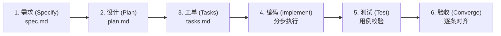

# 规范驱动工程引擎 (Spec-Driven Development / SDD)

参考 GitHub 官方开源规范驱动工具链（`github/spec-kit`）与工业级 SDLC 生命周期，确立人机协作的标准交付机制。

> **核心铁律**：严禁未经「需求对齐」与「架构设计确认」直接跳到编写代码（Implement）。没有经过用户签章的 Spec 与 Plan，任何代码都是无效的技术负债。

---

## 六阶段标准工程流 (The 6-Step Pipeline)

---

### 第一阶段：需求规格化 (Specify · 需求)
**目标**：回答“为什么做（Why）”和“做成什么样（What）”，坚决不涉及具体实现细节与技术选型。
1. **痛点与意图澄清**：用户当前被什么卡住了？期望的业务体验是什么？
2. **用户旅程与操作路径**：用户第一步点哪里、第二步看哪里、第三步得到什么反馈。
3. **功能清单 (In-Scope) 与排除清单 (Out-of-Scope)**：明确这次“做什么”以及坚决“不做什么”。
4. **可量化验收标准 (Acceptance Criteria)**：
   - 规则清晰，必须是可以客观判断“是/否通过”的断言。
5. **交付物**：在项目或临时目录生成 `docs/specs/{feature_name}/spec.md`。
> 🛑 **阶段闸门**：必须等待用户确认“这正是我的真实需求”后，才允许进入第二阶段。

---

### 第二阶段：架构设计与方案 (Plan · 设计)
**目标**：回答“怎么做（How）”，制定技术蓝图、数据结构与交互线框。
1. **数据模型与存储设计**：表结构、字段类型、索引、本地/数据库持久化方案。
2. **接口与契约 (API / State Contracts)**：端点、入参、出参、错误状态码。
3. **UI/UX 结构线框与布局哲学**：信息密度、层级流向、动效节奏（对标行业标杆，如 Raycast / Linear / Qiang-Z）。
4. **技术对比与最简选型**：推荐最简单可行的方案，并列出备选方案与取舍原因。
5. **交付物**：在项目目录生成 `docs/specs/{feature_name}/plan.md`。
> 🛑 **阶段闸门**：向用户展示方案全貌与页面结构规划，获得架构确认后方可进入拆解。

---

### 第三阶段：任务工单化 (Tasks · 开发计划)
**目标**：将宏观方案拆解为细粒度、带前后依赖、可独立验证的执行工单。
1. **拆解粒度**：每个 Task 工作量不超过单次代码编写范围，且必须附带独立的验证命令或步骤。
2. **前后依赖图**：区分哪些任务可以并行，哪些任务必须前置（如数据库表迁移必须先于业务接口）。
3. **风险预案**：标出高风险点（如网络沙箱、并发竞争、状态回退）。
4. **交付物**：在项目目录生成 `docs/specs/{feature_name}/tasks.md`，使用 `- [ ]` 复选框组织。
> 🛑 **阶段闸门**：任务清单由用户审阅确认无遗漏。

---

### 第四阶段：精准编码实现 (Implement · 开发)
**目标**：AI 扮演精准可靠的工程执行者，严格按照 `tasks.md` 逐条实施。
1. **单点推进**：一次只做一个工单，严禁跨工单散发修改无关文件。
2. **中文注释与严格类型**：必须符合全局通用编码规范与项目规则。
3. **自测闭环**：每完成一个工单，必须立即自运行并确认无语法和逻辑异常，随后在 `tasks.md` 中打勾 `[x]`。

---

### 第五阶段：测试与健壮性验证 (Test · 测试)
**目标**：用实际用例压测边界与失败场景。
1. **冒烟测试**：核心正常流打通（从输入到呈现全链路无阻碍）。
2. **边界与异常测试**：输入为空、超长文本、网络断开、撤销冲突等。
3. **端到端体验验证**：前端渲染是否有抖动、后端事务是否能回滚、状态是否真实持久化。

---

### 第六阶段：收敛与验收 (Converge · 验收)
**目标**：对照第一阶段的 `spec.md` 验收标准逐条点检，完成交付。
1. **验收清单点检**：输出清晰的验收矩阵表格（需求条目 vs 实现状态 vs 验证证据）。
2. **差异与遗留说明**：如果有未满足项，明确列为后续阶段计划（Hold），不含糊糊弄。
3. **文档与工作台同步**：将成果物路径、核心决策与唯一步伐登记到个人工作台（`workbench.db`）。
